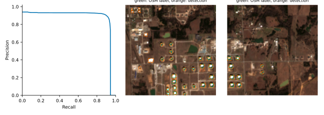
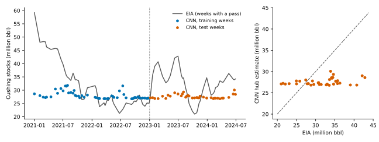

> **DRAFT SHELL: no model has been trained yet. Every bracketed value is filled from results files when the pipeline is run.**

# Abstract

A pre-registered study found that geometric shadow methods on free 10 m Sentinel-2 imagery could not recover floating-roof heights at Cushing, Oklahoma (mean crescent-to-roof contrast-to-noise ratio 0.34 against a threshold of 2.0). This follow-up asks a different question: can a convolutional network, trained on 2021-01-01 to 2022-12-31 and tested on 2023-01-01 to 2024-06-30, track weekly EIA Cushing stocks from tank-level image chips? Tank locations come from OpenStreetMap, a YOLO detector is evaluated on held-out terminals, and a chip-level network is supervised only by hub-level EIA totals. The analysis is exploratory because the test period had already been inspected in the earlier study. [not yet run] [not yet run] [not yet run] Per-tank fill accuracy could not be tested because no per-tank labels exist.

# 1. Introduction

The earlier pre-registered study (Protocol 2.0.0) tested three shadow-geometry methods on 10 tanks in one scene. The methods met the accuracy criterion on 3, 1 and 2 tanks respectively, and the roof-contrast check failed. That result says shadow geometry is too weak at 10 m. It does not say the imagery carries no inventory signal. A learned model can use reflectance and context that a geometric method ignores, so the question is worth one more test, with baselines for season and sun angle and an honest label of its status.

This paper reports that test. It is **not** confirmatory. The 2023 and 2024 windows were opened during the earlier study, and the design here was chosen after seeing that result.

# 2. Data

**Imagery.** Sentinel-2 L2A scenes for tiles T14SQE and T14SPE, cloud cover at most 20% at product level, mosaicked onto a common 10 m grid. Bands B02, B03, B04 and B08 are native 10 m; B11 and B12 are resampled from 20 m. Reflectance is DN scaled by the per-product offset and gain.

**Tank registry.** Storage tanks were taken from OpenStreetMap (man_made=storage_tank) around Cushing. Diameter comes from the footprint polygon where available. OSM carries no capacity, so each tank is weighted by its footprint area. This is a proxy, not capacity.

**Labels.** There are no per-tank fill labels. The only supervision is the EIA weekly Cushing stock series, which covers the whole hub and includes tanks outside the registry.

**Splits.** Training uses 2021-01-01 to 2022-12-31. Testing uses 2023-01-01 to 2024-06-30. For detection, whole terminals (clusters of tanks within 1.5 km) are held out, so test tanks are spatially separate from training tanks.

# 3. Methods

**Detection (Stage 1).** A YOLOv8-nano detector was trained on 4x upscaled false-colour windows (B04, B03, B02) with labels drawn automatically from OSM footprints. It is scored on held-out terminals on test-period dates. Hypothesis H1: mAP@50 at least 0.85 and precision at least 0.80.

**Fill regression (Stage 2).** A small convolutional network takes a 16 x 16 x 6 chip per tank plus sun-geometry inputs and outputs a fill fraction. The hub estimate is the area-weighted mean fill over valid tanks, mapped to barrels by a positive affine transform fitted against EIA on training weeks. Five seeds are averaged. Early stopping uses a chronological inner validation split inside the training years.

**Baselines.** To control for season and sun angle, the CNN is compared with (a) the training mean, (b) ridge regression on area-weighted disc reflectance (B04, B08, B11) plus sun elevation, (c) ridge on the same four sun-geometry terms the CNN receives, and (d) ridge on day-of-year harmonics.

**Statistics (Stage 3).** Pearson r, Spearman rho and R-squared on weekly pairs; first-difference correlation at lag 0 and 1 using strictly consecutive weeks. Confidence intervals use a stationary block bootstrap (mean block 4 weeks, 10000 draws). Hypothesis H3 requires, on the test weeks, (i) r of at least 0.70 with a naive p below .001 and a bootstrap interval above zero, because the naive test ignores autocorrelation; (ii) bootstrap intervals above zero for the first-difference correlation at **both** lag 0 and lag 1; and (iii) a higher R-squared than every baseline. H2 (per-tank MAE below 15% of capacity) is not tested.

# 4. Results

*Not yet generated: run the pipeline (see paper/RUNBOOK_ML.md).*

[not yet run]

*Not yet generated: run the pipeline (see paper/RUNBOOK_ML.md).*

*Not yet generated: run the pipeline (see paper/RUNBOOK_ML.md).*

[not yet run] [not yet run]

# 5. Discussion

Interpretation depends on the verdicts above and on the baseline comparison. A high level correlation that a sun-elevation-only model matches would indicate a seasonal artefact, not an inventory signal. A first-difference correlation is the stricter check, since it removes slow trends shared by both series.

# 6. Limitations

1. The analysis is post hoc and the test windows were inspected earlier, so results are exploratory.
2. The registry comes from OSM and has no capacity. Area weights are a proxy.
3. Supervision is hub-level and weak; the network is not shown to read individual tank fill, and H2 is untested.
4. Auto-labelled detection ground truth is noisy: tanks absent from OSM count as false positives.
5. The number of weekly pairs is small, so intervals are wide and the naive p-value is optimistic.
6. EIA Cushing stocks include fixed-roof tanks and pipeline fill, which satellites cannot see in the same way.
7. Seasonal and sun-angle effects confound any single-hub series, even with baselines.

# 7. Conclusion

[not yet run] The earlier negative result on shadow geometry stands unchanged. Any positive finding here needs confirmation on a window not previously opened.

# Data and Code Availability

Code, configuration and the checksum manifest are in the project repository. Raw imagery and EIA data are public. All numbers in this paper are generated from files in `results/` by `src/ml/report.py`.
