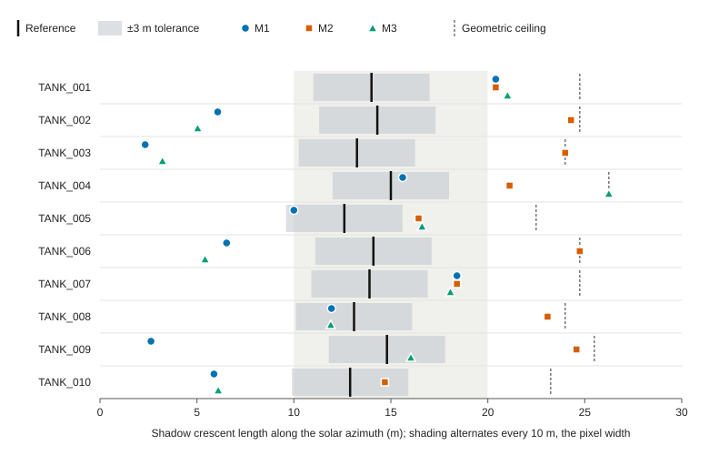

<!-- Generated into paper/paper_confirmatory.md by src/report/make_confirmatory_report.py. Edit this template, not the output. -->

# Empirical Limits of Free 10-Meter Sentinel-2 Imagery for Floating-Roof Oil Storage Monitoring: A Pre-Registered Confirmatory Study at Cushing, Oklahoma

[Author names and affiliations to be added]

## Abstract

Free 10 m Sentinel-2 imagery would make crude storage monitoring widely accessible if the shadow that a floating-roof tank's shell casts on its roof could be measured reliably. We tested this in a pre-registered confirmatory study (Protocol 2.0.0, locked 2026-11-03) at Cushing, Oklahoma, using an untouched 2024-01-01 to 2024-06-30 window, 10 eligible tanks, and blinded human readings as the reference (mean inter-rater difference 0.41 m). Three frozen methods were compared: single-band thresholding (M1), a multi-band spectral index (M2), and a sub-pixel radial gradient (M3). Question 1 required at least 80% of tanks within ±3.0 m and a median absolute residual of at most 2.0 m. No method came close: pass rates were 30.0%, 10.0% and 20.0% for M1, M2 and M3, and median absolute residuals ranged from 6.71 to 8.09 m. Question 2 offers an explanation. The mean contrast-to-noise ratio of the shadow crescent was 0.34 (range 0.07 to 0.93; threshold 2.0), so the signal sat below sensor noise at all 10 tanks. Question 3, agreement with weekly stock changes from the U.S. Energy Information Administration (EIA), was conditional on Question 1 and was not tested. All 10 tanks were evaluated on one acquisition (2024-01-29), and 61.1% of products from the two target tiles were excluded for cloud cover. The result is a negative one for these three methods at 10 m. It does not test finer optical or radar sensors, which the literature identifies as candidates.

*Keywords:* Sentinel-2, floating-roof tanks, crude oil storage, pre-registration, negative result, Cushing

## Introduction

Crude oil held in storage is a closely watched quantity, and the EIA publishes weekly stock figures for Cushing, Oklahoma. A free, global, satellite-based estimate could complement them if it were accurate enough. Sentinel-2 is the obvious candidate: its multispectral instrument delivers 10 m pixels in the blue, green, red and near-infrared bands and 20 m pixels in the shortwave infrared band used here (Drusch et al., 2012; European Space Agency, n.d.), and the data are free.

The measurement idea is geometric. An external floating-roof tank has a roof that rides on the liquid, so the roof sinks as the tank empties. The fixed shell above the roof then casts a shadow across the roof surface, and on flat ground its length along the solar azimuth is L = d / tan(α), where d is the drop of the roof below the rim and α is the solar elevation. Shadow length therefore tracks fill level, and published methods use it to infer reserve status, height or volume (Wang et al., 2016; Wang et al., 2019).

Whether that works depends on resolution. Wang et al. (2019) estimated tank height from shadows in Gaofen-2 imagery with 0.81 m panchromatic and 3.2 m multispectral bands and reported a mean absolute height error of 0.238 m on a 21.8 m tank. Spaceborne radar offers a different route through double-bounce geometry: Villamil Lopez and Stilla (2021) estimated fill for floating-roof tanks from TerraSAR-X data over Rotterdam, and Tsai et al. (2024) reported tracking floating-roof height changes with TerraSAR-X spotlight data. Comparisons of satellite-derived Cushing stocks with EIA data also exist, but the two we located are trade and vendor reports that describe agreement qualitatively or as survey totals (Kayrros, 2021; "DigitalGlobe Satellite Validates U.S. Oil Inventory," 2011). In the literature we reviewed, we found no peer-reviewed, pre-registered assessment of free 10 m imagery for this task.

At 10 m, the geometry is unfavorable. The tanks in this study are 7 to 9 pixels across, and the blinded reference crescent lengths (12.6 to 15.0 m) span only 1.3 to 1.5 pixels. We ask three questions, registered before the 2024 data were opened. Q1: does any frozen method reproduce human-verified shadow lengths well enough to count as a valid measurement? Q2: is the shadow contrast larger than sensor noise at this resolution? Q3: if Q1 passes, do the resulting series carry information about EIA stock changes?

## Method

### Pre-Registration and Data

The protocol was frozen as Pre-Registration v2 (Protocol 2.0.0; `docs/prereg_v2.md`, `configs/prereg_v2.yaml`) and locked in commit `ede4a3f` on 2026-11-03, following the logic of separating confirmatory from exploratory work (Nosek et al., 2018). The confirmatory test window is 2024-01-01 to 2024-06-30. The 2024 data files first appear in the repository in commit `8087717`, after the lock; the manifest does not record retrieval times for them, so that ordering rests on the commit history. Deviations and reporting notes identified while writing up are listed in `docs/deviations.md`.

Imagery is Sentinel-2 Level-2A from the Copernicus Data Space Ecosystem, tiles T14SQE (primary) and T14SPE. The 2024 catalogue holds 144 products over 36 acquisition dates across four tiles. Rasters for the evaluated scene comprise B02, B03, B04, B08, B11 (native 20 m) and the true-color image. The tank set is the pre-declared registry of 10 external floating-roof crude tanks (radius 35 to 45 m, shell height 16.5 to 19.0 m), with no additions or substitutions.

### Human Reference

Two trained inspectors measured the crescent independently on true-color and B04 rasters at 1:1 native resolution under a 2% linear stretch, along the solar azimuth from the southern shell rim to the inner shadow-illuminated floor boundary. They were required to be blind to algorithm output and to EIA figures. When the two readings differed by at most 1.5 m the reference was their mean; otherwise a joint adjudication would be logged. All 10 tanks were resolved by the mean (largest difference 0.50 m). Mean absolute difference was 0.41 m and Pearson *r* = .91. All readings come from S2B_MSIL2A_20240129T171549 (2024-01-29; solar elevation 33.7°, azimuth 158.8°).

### Candidate Methods

All methods were frozen before data ingestion, as described in the protocol. M1 applies Otsu thresholding to the B04 band inside the tank's bounding circle and measures the contiguous dark run along the solar azimuth. M2 classifies shadow pixels with a spectral shadow index, SI = (1 − NIR)(1 − Red) / (1 + SWIR1), against a fixed threshold of 0.45, using B02, B03, B04, B08 and B11. M3 interpolates B04 along the azimuth ray with a cubic spline at 1 m steps and places the edge at the maximum positive gradient inside the tank radius. The configuration file lists a different band set and index name for M2 (Note 006 in `docs/deviations.md`); the description above follows the protocol document.

### Question Definitions

For Q1 a tank passes when its absolute residual against the reference is at most 3.0 m. A method passes when at least 80% of tanks pass and its median absolute residual is at most 2.0 m; if no method meets both criteria, Q1 fails. The protocol specifies Holm–Bonferroni correction across the three methods (Holm, 1979) without naming a test statistic. We therefore report a one-sided exact binomial test of the null that a method's pass probability is at most 0.80, Holm-adjusted across the three methods, as a post hoc operationalization (Deviation 003). The verdicts depend only on the registered thresholds.

For Q2, the contrast-to-noise ratio is CNR = |μ_crescent − μ_roof| / σ_noise, where σ_noise is estimated from static paved surfaces beside the tank farms. The registered detectability threshold is CNR ≥ 2.0, evaluated for every eligible tank regardless of the Q1 outcome. Q3 is tested if and only if at least one method passes Q1. A physical plausibility check requires 0 ≤ L ≤ (H − 1.5 m) / tan(α), where H is the shell height, and treats an extraction with more than 20% anomalous tanks as invalid.

## Results

### Question 1: Measurement Validity

Q1 fails. No method reached the pass-rate criterion or the median criterion (Table 1). M1 placed 3 of 10 tanks within tolerance, M2 placed 1 and M3 placed 2. Median absolute residuals were 6.71, 8.09 and 6.91 m against a requirement of 2.0 m. Holm-adjusted *p* values were > .999 for all three methods, which gives no evidence that any method reaches the gate.

**Table 1**

*Question 1: Agreement Between Automated Shadow Lengths and the Blinded Human Reference (N = 10 Tanks)*

| Method | Passes | Pass rate (%) | *Mdn* abs. residual (m) | *M* abs. residual (m) | *M* signed residual (m) | *p* | Holm-adjusted *p* | Criteria met | Verdict |
|:--|--:|--:|--:|--:|--:|--:|--:|:--|:--|
| M1: Single-band threshold (B04) | 3/10 | 30.0 | 6.71 | 6.12 | −3.81 | > .999 | > .999 | No / No | FAIL |
| M2: Multi-band spectral index | 1/10 | 10.0 | 8.09 | 7.38 | 7.38 | > .999 | > .999 | No / No | FAIL |
| M3: Sub-pixel radial gradient (B04) | 2/10 | 20.0 | 6.91 | 6.36 | −0.83 | > .999 | > .999 | No / No | FAIL |

*Note.* A tank passes when its absolute residual is at most 3.0 m. Registered criteria: pass rate ≥ 80% and median absolute residual ≤ 2.0 m ("Criteria met" lists rate / median). Signed residual is automated minus reference, so positive values are overestimates. *p* is a one-sided exact binomial test of H~0~: pass probability ≤ 0.80, Holm–Bonferroni adjusted across the three methods. The protocol names the correction but not the test statistic, so this test is a post hoc operationalization (Deviation 003 in `docs/deviations.md`); verdicts rest on the registered thresholds, not on *p*.

The errors differ in character. M2 overestimated the shadow on all 10 tanks (mean signed residual 7.38 m), while M1 (mean −3.81 m; 3 overestimates) and M3 (mean −0.83 m; 5 overestimates) erred in both directions. Selecting the best method separately for each tank would not have rescued the result: only 5 of 10 tanks (50.0%) had at least one method within tolerance, and 5 tanks had none. Figure 1 shows the estimates against the reference in units of the pixel width.

**Figure 1**

*Reference Crescent Length and Automated Estimates in Units of the 10 m Pixel*

*Note.* Markers show M1 (circle), M2 (square) and M3 (triangle). The black tick is the blinded human reference, the gray band is the ±3.0 m tolerance, and the dashed line is each tank's geometric ceiling. This figure is built from the per-tank result file; a true radial-profile figure needs the 10 m rasters, which are not distributed with the repository.

### Question 2: Contrast-to-Noise Diagnostic

Q2 fails: the crescent is noise-dominated at 10 m (Table 2). The mean CNR was 0.34 (range 0.07 to 0.93) against a threshold of 2.0, and all 10 tanks fell below it; all 10 were also below 1.0. Noise estimates ranged from 395 to 3191 DN and exceeded the contrast between the crescent and roof windows. This gives a mechanistic explanation for the Q1 outcome that does not depend on the details of any one method.

**Table 2**

*Question 2: Contrast-to-Noise Diagnostic for the Shadow Crescent at 10 m Resolution*

| Tank | μ~crescent~ (DN) | μ~roof~ (DN) | Signed contrast (DN) | σ~noise~ (DN) | CNR | Status |
|:--|--:|--:|--:|--:|--:|:--|
| TANK_001 | 5179.2 | 5988.6 | −809.4 | 1615.2 | 0.50 | Fail: noise dominated |
| TANK_002 | 4213.5 | 3669.1 | 544.4 | 3191.1 | 0.17 | Fail: noise dominated |
| TANK_003 | 5700.0 | 3593.6 | 2106.4 | 2256.7 | 0.93 | Fail: noise dominated |
| TANK_004 | 4069.1 | 4219.7 | −150.6 | 690.2 | 0.22 | Fail: noise dominated |
| TANK_005 | 4244.0 | 4301.0 | −57.0 | 609.0 | 0.09 | Fail: noise dominated |
| TANK_006 | 3343.3 | 3389.1 | −45.8 | 637.9 | 0.07 | Fail: noise dominated |
| TANK_007 | 3815.3 | 4107.9 | −292.6 | 807.9 | 0.36 | Fail: noise dominated |
| TANK_008 | 4264.7 | 4237.7 | 27.0 | 395.1 | 0.07 | Fail: noise dominated |
| TANK_009 | 3987.4 | 4457.1 | −469.7 | 561.3 | 0.84 | Fail: noise dominated |
| TANK_010 | 4118.0 | 3963.2 | 154.8 | 799.0 | 0.19 | Fail: noise dominated |

*Note.* CNR = |μ~crescent~ − μ~roof~| / σ~noise~, with σ~noise~ estimated from static paved surfaces beside the tank farms. The registered detectability threshold is CNR ≥ 2.0. Signed contrast is crescent minus roof; a shadow would be expected to make it negative. DN = digital number.

The signed contrast in Table 2 adds a caution. In 4 of 10 tanks the mean DN in the crescent window was higher than in the roof window, the opposite of what a shadow produces. The registered CNR uses an absolute difference, so these tanks still receive a CNR value, but it is not evidence of a shadow signal.

### Physical Plausibility Check

The physical plausibility check did not invalidate any extraction (Table 3): no estimate lay outside the geometric bounds. Even so, 2 M2 estimates and 1 M3 estimate sat within 0.1 m of the ceiling, which may indicate that the segmentation extended to the limit of its search range.

**Table 3**

*Physical Plausibility of Automated Estimates Against the Geometric Ceiling*

| Method | Above ceiling | Within 0.1 m of ceiling | Anomalous fraction (%) |
|:--|--:|--:|--:|
| M1: Single-band threshold (B04) | 0 | 0 | 0.0 |
| M2: Multi-band spectral index | 0 | 2 | 0.0 |
| M3: Sub-pixel radial gradient (B04) | 0 | 1 | 0.0 |

*Note.* The ceiling for each tank is (*H* − 1.5 m) / tan(α), with *H* the registry shell height and α the solar elevation of the acquisition. The protocol treats an extraction with more than 20% anomalous tanks as invalid.

### Question 3: Not Tested

Q3 is not tested. It was registered as conditional on Q1, every method failed Q1, and running it would have compared an invalid measurement series with macro-level benchmark data. No Q3 result is reported.

## Discussion

### Interpretation

Under a protocol fixed in advance, none of the three frozen methods turned a 10 m Sentinel-2 scene into usable shadow lengths for these tanks, and the diagnostic indicates why. A reference crescent of 1.3 to 1.5 pixels is blended with its surroundings by the sensor's point spread function and by pixel sampling, so the boundary between shadow and lit roof is smeared across the same one or two pixels the method must resolve. The Q2 result quantifies the consequence: the intensity step is smaller than the estimated noise. These explanations are consistent with the data but were not isolated experimentally; the committed files do not contain radial profiles or point-spread measurements.

Mixed-sign errors from M1 and M3 are consistent with edge placement driven by noise. The one-sided bias of M2 suggests its index threshold segmented more than the crescent, though we cannot confirm this without the run's code (Note 007).

For scale, the 3.0 m tolerance corresponds, at the solar elevation of this scene, to a roof-height change of about 2.0 m. With 24 to 40 thousand barrels per metre of roof height at the registry radii, that is roughly 48 to 80 thousand barrels per tank. This is illustrative arithmetic for cylindrical tanks, not a registered criterion.

### What the Reference Can and Cannot Show

Agreement between inspectors was high (0.41 m mean absolute difference), and the inspectors could place a crescent on every tank, which suggests that a person can see the shadow when using the tank outline as context. The reference measures what blinded people read from the same 10 m raster; it is not an in-situ roof-height measurement. It therefore tests whether algorithms reproduce human reading, not physical accuracy. The reference lengths also span a narrow range (12.6 to 15.0 m), which limits how much variation in fill level the ten tanks represent on this date.

### Limitations

All 10 tanks come from a single acquisition, so tank-to-tank variation and temporal variation are confounded and the effective sample is one scene and one sun geometry. Shadows are longer at lower solar elevation, so a winter scene is plausibly among the more favorable cases for detection; summer geometry would likely be harder, though we did not test it. Ten tanks is a small sample, although the failure is not marginal: even a per-tank best-of-three choice reached 50.0%.

Cloud screening used scene-level cloud cover from the catalogue rather than the tank-footprint Scene Classification Layer rule in the protocol (Note 004). On that basis 44 of 72 products from the two target tiles (61.1%) exceeded the 20% threshold, and only 14 of 36 acquisition dates were at or below it on the primary tile. Even a method that worked would yield a sparse series.

The M1–M3 and CNR code behind the result files is not in the repository, the rasters are not distributed with it, and the two registered descriptions of M2 differ. These are recorded as Notes 006 and 007, and the single-scene design as Note 005. The scope of the claim is correspondingly narrow: three specific methods, one scene, one site.

### Exploratory History and Voided Analyses

Two earlier events shaped this study and are disclosed in `docs/deviations.md`. In Incident 001, exploratory runs on 2021–2023 data were voided because the extraction code cropped windows from downsampled preview thumbnails of about 290 m per pixel rather than native 10 m rasters; the metrics and the hypothesis claims derived from them were retracted. In Incident 002, a stop gate on ten native 10 m December 2023 verification scenes failed: radial thresholding passed 0 of 10 tanks and sub-pixel gradient detection passed 1 of 10. The 2021–2023 period was therefore closed to confirmatory claims, and the confirmatory study was registered on the unopened 2024 window.

### Implications

The results indicate that the tested 10 m approaches do not give usable shadow lengths at Cushing, and the contrast diagnostic suggests that improvement would have to come from higher resolution or different physics rather than from tuning thresholds on these data. The literature points to candidates: shadow-based estimation with sub-metre to 3 m optical imagery (Wang et al., 2019) and radar methods based on double-bounce geometry (Villamil Lopez & Stilla, 2021; Tsai et al., 2024). We did not test them, and our data cannot say what resolution suffices. Evaluating such sensors under the same pre-registered gate and CNR diagnostic is the natural next step.

## Reproducibility and Code Availability

The repository is at https://github.com/mayankt411/Drip. The protocol lock is commit `ede4a3f`; the result files were committed in `8087717`. Data provenance and SHA-256 checksums are in `data/manifest.csv`, and `src/acquire/verify_manifest.py` checks them against a local checkout (two of the 2024 JSON checksums were computed on CRLF copies; see Note 008). The tables, Figure 1 and every number in this paper are generated from the committed result files by `src/report/make_confirmatory_report.py`, which also checks that its recomputed pass counts, medians and CNR values agree with the committed summary files. The Sentinel-2 rasters are excluded from version control because of their size and must be downloaded from the Copernicus Data Space Ecosystem. The code that produced the three result CSVs from the rasters is not yet committed (Note 007), so the results are archived but not yet regenerable from this repository alone.

## References

DigitalGlobe satellite validates U.S. oil inventory. (2011, August 1). *EI Journal*. https://eijournal.com/?p=4661

Drusch, M., Del Bello, U., Carlier, S., Colin, O., Fernandez, V., Gascon, F., Hoersch, B., Isola, C., Laberinti, P., Martimort, P., Meygret, A., Spoto, F., Sy, O., Marchese, F., & Bargellini, P. (2012). Sentinel-2: ESA's optical high-resolution mission for GMES operational services. *Remote Sensing of Environment, 120*, 25–36. https://doi.org/10.1016/j.rse.2011.11.026

European Space Agency. (n.d.). *MultiSpectral Instrument (MSI) overview*. Sentinel-2 MSI Technical Guide, Copernicus Sentinel Online. Retrieved November 4, 2026, from https://sentinels.copernicus.eu/web/sentinel/technical-guides/sentinel-2-msi/msi-instrument

Holm, S. (1979). A simple sequentially rejective multiple test procedure. *Scandinavian Journal of Statistics, 6*(2), 65–70.

Kayrros. (2021, August 18). *Drone flights over Cushing: Bringing transparency on crude inventories to 100%*. https://kayrros.com/drone-flights-over-cushing-bringing-transparency-on-crude-inventories-to-100/

Nosek, B. A., Ebersole, C. R., DeHaven, A. C., & Mellor, D. T. (2018). The preregistration revolution. *Proceedings of the National Academy of Sciences, 115*(11), 2600–2606. https://doi.org/10.1073/pnas.1708274114

Tsai, Y.-L. S., Huang, C.-J., Chen, C.-L., & Han, J.-Y. (2024). Automatic monitoring of oil tank 3D geometry and storage changes with interferometric coherence and SAR intensity information. *IEEE Journal of Selected Topics in Applied Earth Observations and Remote Sensing, 17*, 1584–1595. https://doi.org/10.1109/JSTARS.2023.3337126

Villamil Lopez, C., & Stilla, U. (2021). Monitoring of oil tank filling with spaceborne SAR using coherent scatterers. *IEEE Journal of Selected Topics in Applied Earth Observations and Remote Sensing, 14*, 5638–5655. https://doi.org/10.1109/JSTARS.2021.3082181

Wang, Q., Zhang, J., & Hu, X. (2016). Automatic oil reserve analysis through the shadows of exterior floating crest oil tanks in highlight optical satellite images. In G. Bebis et al. (Eds.), *Advances in visual computing: ISVC 2016* (Lecture Notes in Computer Science, Vol. 10073, pp. 23–32). Springer. https://doi.org/10.1007/978-3-319-50832-0_3

Wang, T., Li, Y., Yu, S., & Liu, Y. (2019). Estimating the volume of oil tanks based on high-resolution remote sensing images. *Remote Sensing, 11*(7), Article 793. https://doi.org/10.3390/rs11070793
