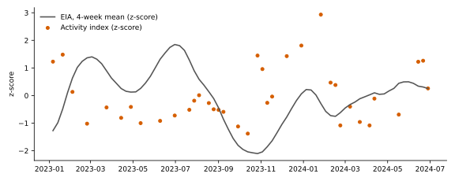

# Abstract

This exploratory study asks three questions about free 10 m Sentinel-2 imagery of the Cushing storage hub: can a detector find the tanks, can a network tell floating-roof from fixed-dome tanks, and does a hub-level spectral activity index follow EIA stocks? The detector did not meet the targets: mAP@50 0.876, precision 0.900. Structural classification could not be tested: too few OSM-labelled tanks per class (train [0, 0], held-out [0, 0]). The smoothed activity index had r = −0.21 with EIA stocks over 37 test weeks (raw EIA: r = −0.15; season-only control: r = 0.31); the criteria were not all met. The analysis is post hoc: the 2023 and 2024 windows were inspected in an earlier pre-registered study and in a first ML analysis, and targets were set after those results.

# 1. Background

An earlier pre-registered study found that shadow geometry could not recover floating-roof height at 10 m. A first ML analysis then showed that a CNN supervised by hub-level EIA stocks did not track them. This framework asks narrower questions that 10 m imagery might support.

# 2. Data

Sentinel-2 L2A tiles T14SQE and T14SPE, bands B02, B03, B04, B08, B11 and B12 on a common 10 m grid. Tanks come from OpenStreetMap. Development years are 2021–2022 and evaluation years 2023–2024. Test tanks come from held-out terminal clusters. EIA stocks are series W_EPC0_SAX_YCUOK_MBBL.

# 3. Methods

**H1.** A YOLO detector is trained on training terminals and scored on held-out terminals. Detector sizes were compared on validation images only.

**H2.** Structural labels come only from OSM roof tags. A small CNN on temporal-mean multi-spectral chips is compared with a ridge classifier and with the majority class. Operational labels (active versus idle) have no independent source, so that task is not tested. Per-tank spectral variance is saved as a descriptive index only.

**H3.** The activity index is each tank's relative departure from its own development-year reflectance in B04, B08 and B11, area-weighted across valid tanks and averaged by week. It is not a stock level. It is correlated with EIA stocks, raw and as a 4-week mean, with a stationary block bootstrap and a day-of-year control fitted on development years. H3 passes only if r, the naive p, a bootstrap interval above zero and the control comparison all pass.

# 4. Results

**Table 1**

*Tank Detection on Held-Out Terminals*

| Metric | Value | Target |
|:--|--:|--:|
| mAP@50 | 0.876 | ≥ 0.90 |
| Precision | 0.900 | ≥ 0.85 |
| Recall | 0.903 | n/a |
| Test images / labelled tanks | 620 / 18047 | n/a |

The detector did not meet the targets: mAP@50 0.876, precision 0.900.

**Table 2**

*Structural and Operational Classification*

| Task | Model | Status | *n* | Accuracy | Macro F1 |
|:--|:--|:--|--:|--:|--:|
| operational active vs idle | none | not testable | n/a | n/a | n/a |
| structural floating vs fixed | none | not testable | n/a | n/a | n/a |

Structural classification could not be tested: too few OSM-labelled tanks per class (train [0, 0], held-out [0, 0]). Operational (active versus idle) classification was not tested because no independent activity labels exist.

**Table 3**

*Hub Activity Index Against EIA Cushing Stocks, Test Weeks 2023–2024*

| Comparison | *n* | *r* | *p* | 95% CI | ρ |
|:--|--:|--:|--:|:--|--:|
| index vs eia raw | 37 | −0.15 | .376 | [−0.49, 0.19] | −0.09 |
| index vs eia 4wk smoothed | 37 | −0.21 | .216 | [−0.52, 0.10] | −0.19 |
| season only vs eia raw | 37 | 0.46 | .004 | [−0.10, 0.76] | 0.39 |
| season only vs eia 4wk smoothed | 37 | 0.31 | .066 | [−0.29, 0.72] | 0.24 |
| index vs eia first difference lag0 | 13 | −0.48 | .101 | [−0.82, 0.17] | −0.47 |

*Note.* *p* is the naive Pearson test; smoothing the EIA series adds autocorrelation, so it is optimistic. Intervals are stationary block bootstrap.

The smoothed activity index had r = −0.21 with EIA stocks over 37 test weeks (raw EIA: r = −0.15; season-only control: r = 0.31); the criteria were not all met.

# 5. Limitations

1. The analysis is post hoc and targets followed earlier results.
2. OSM roof tags may be sparse, which limits H2.
3. Activity cannot be validated without independent operational labels.
4. Smoothing EIA stocks makes weekly points dependent, so naive p-values are optimistic.
5. The activity index is confounded with season and vegetation, which the day-of-year control only partly addresses.
6. The registry has few terminal clusters, so the spatial split is coarse.

# 6. Conclusion

The smoothed activity index had r = −0.21 with EIA stocks over 37 test weeks (raw EIA: r = −0.15; season-only control: r = 0.31); the criteria were not all met. Any positive result needs confirmation on a window not previously opened.
