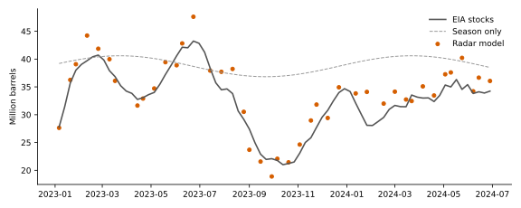

# Abstract

Hypothesis 3 was re-tested with Sentinel-1 radar. Verdict: fail. On 42 test weeks the radar model had *r* = 0.94, *p* < .001, *R*² = 0.80; the best baseline *R*² was −1.16. Criteria not met: diff.

# Method

Backscatter (VV and VH, radiometrically terrain-corrected) was read for each of the 413 mapped tanks on every Sentinel-1 pass from 2018 to June 2024 (450 pass-orbit combinations). For each tank and orbit, the training-period mean was subtracted, so the features measure how far a tank sits from its own usual return: disc mean VV, disc maximum VV, disc mean VH, and disc minus rim VV. Features were averaged over tanks (weighted by footprint area), then over each EIA week. A ridge regression with time-blocked cross-validation was fitted on weeks up to 2022 and scored once on 2023 to June 2024. The seasonal baseline uses day-of-year harmonics fitted on the same training weeks.

The criteria were fixed in advance: *r* ≥ 0.65, *p* < .001, a bootstrap interval above zero, first-difference intervals above zero at lags 0 and 1, and an *R*² above both baselines.

# Results

**Table 4**

*Radar Predictions Against EIA Cushing Stocks, Test Weeks 2023–2024*

| Model | Comparison | *n* | *r* | *p* | 95% CI | *R*² |
|:--|:--|--:|--:|--:|:--|--:|
| Radar, all tanks | level | 42 | 0.94 | < .001 | [0.87, 0.97] | 0.80 |
| Radar, all tanks | diff lag0 | 10 | 0.70 | .025 | [−0.15, 0.94] | n/a |
| Radar, all tanks | diff lag1 | 10 | 0.72 | .020 | [−0.31, 0.95] | n/a |
| Radar, large tanks | level | 42 | 0.94 | < .001 | [0.87, 0.97] | 0.75 |
| Radar, large tanks | diff lag0 | 10 | 0.57 | .085 | [−0.46, 0.91] | n/a |
| Radar, large tanks | diff lag1 | 10 | 0.66 | .039 | [−0.61, 0.94] | n/a |
| Radar + season | level | 42 | 0.95 | < .001 | [0.87, 0.97] | 0.73 |
| Radar + season | diff lag0 | 10 | 0.70 | .023 | [−0.13, 0.94] | n/a |
| Radar + season | diff lag1 | 10 | 0.72 | .019 | [−0.29, 0.94] | n/a |
| Season only | level | 42 | 0.57 | < .001 | [0.03, 0.81] | −1.16 |
| Season only | diff lag0 | 10 | 0.37 | .294 | [−0.45, 0.81] | n/a |
| Season only | diff lag1 | 10 | 0.26 | .477 | [−0.58, 0.79] | n/a |
| Training mean | level | 42 | n/a | n/a | [n/a, n/a] | −1.22 |
| Training mean | diff lag0 | 10 | n/a | n/a | [n/a, n/a] | n/a |
| Training mean | diff lag1 | 10 | n/a | n/a | [n/a, n/a] | n/a |

*Note.* Season-only and training-mean rows are scored on the same weeks as the radar model. Large-tank and season variants are reported, not used for the verdict.

On 42 test weeks the radar model had *r* = 0.94, *p* < .001, *R*² = 0.80; the best baseline *R*² was −1.16. Criteria not met: diff.

# Limitations

Free 10 m imagery gives 4 to 30 pixels per tank. Tank roof type is unlabelled in OpenStreetMap, so floating-roof tanks could not be isolated. EIA reports the whole Cushing hub, while the registry covers mapped tanks only. Weeks without a pass are left blank rather than filled.
